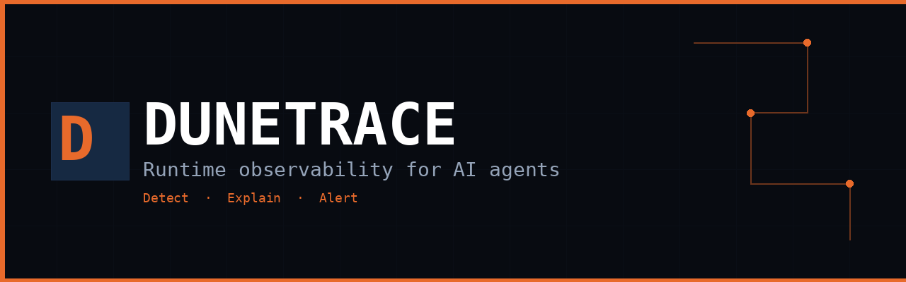
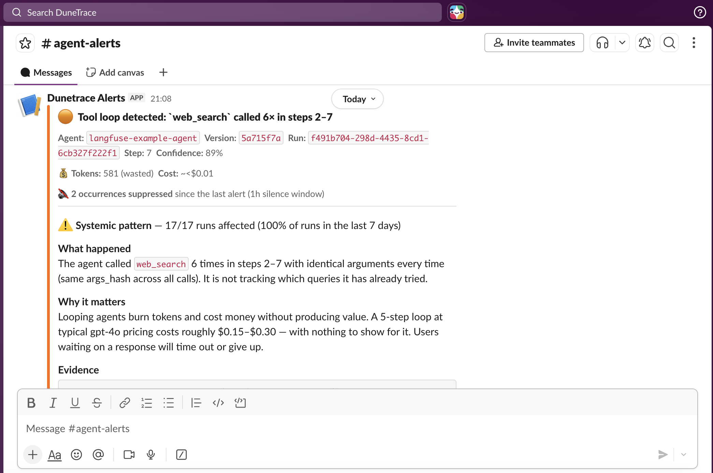
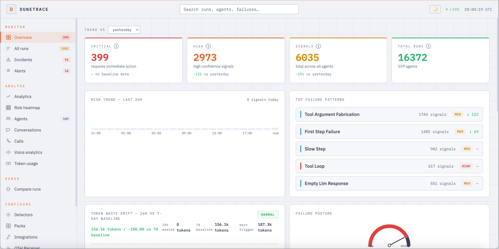

# Dunetrace



**Runtime reliability for AI agents. Structural and semantic detection, runtime prevention, native root cause, and one-click fixes.**

[](https://pypi.org/project/dunetrace/)
[](https://www.npmjs.com/package/dunetrace)
[](https://github.com/dunetrace/dunetrace/actions/workflows/ci.yml)
[](LICENSE)
[](https://discord.gg/yxFjATwHW4)

AI agents fail silently. The API returns 200, latency and cost look normal, and yet:

- ✗ The upstream API returned an error body. The agent invented the numbers and reported success.
- ✗ Two agents delegated in a circle. Eight runs, all green, no progress.
- ✗ A document your agent read last week wrote an instruction into its memory. It fired today.

Tracers answer "what happened?", after you already know it broke. Dunetrace answers
**"is something breaking right now?"** with deterministic, zero-LLM checks on every run,
and in the request path, where a policy can block the action before it executes.

---

## Quick Start

You need Docker, plus Python 3.11+ or Node.js 22+.

**1. Start Dunetrace** (runs on localhost with auth off)

```bash
git clone https://github.com/dunetrace/dunetrace && cd dunetrace
docker compose -f docker-compose.ghcr.yml up -d
curl -s localhost:8001/ready    # ready once this prints "status":"ok" (the first start pulls images)
```

**2. Watch it catch failures** (no API key, no LLM calls)

```bash
pip install dunetrace
SCENARIO=failures python packages/sdk-py/examples/decorator_agent.py
```

Open **[http://localhost:3000](http://localhost:3000)**. Within a few seconds three runs show
`TOOL_LOOP`, `RETRY_STORM` and `RAG_EMPTY_RETRIEVAL`, each with what fired, why it matters
and how to fix it.

**3. Add it to your own agent**

> **Using Claude Code, Cursor or Codex?** Let the setup skill instrument your repo instead:
> `npx skills add dunetrace/dunetrace-skills --skill dunetrace-setup`, then run
> `/dunetrace-setup` (Claude Code, Cursor) or `$dunetrace-setup` (Codex).

**Python** (`pip install dunetrace`)
```python
from dunetrace import Dunetrace
import openai

dt = Dunetrace()                    # sends to http://localhost:8001
dt.init(agent_id="support-agent")   # auto-instruments OpenAI, Anthropic, Mistral, Bedrock, LangChain,
                                    # LangGraph, CrewAI, FastAPI, Flask, httpx and requests

@dt.agent()                         # each call is one run
def answer(question: str) -> str:
    resp = openai.chat.completions.create(
        model="gpt-4o",
        messages=[{"role": "user", "content": question}],
    )
    return resp.choices[0].message.content
```

**TypeScript / Node.js** (`npm install dunetrace`)
```typescript
import { Dunetrace, autoInstrument } from "dunetrace";
import OpenAI from "openai";

const dt = new Dunetrace();          // sends to http://localhost:8001
autoInstrument({ openai: OpenAI });  // add anthropic: / mistral: too; also patches outbound fetch
const openai = new OpenAI();

await dt.run("support-agent", { model: "gpt-4o" }, async (run) => {   // one run
  await openai.chat.completions.create({
    model: "gpt-4o",
    messages: [{ role: "user", content: "Where is my order?" }],
  });
  run.finalAnswer();
});
```

LLM calls (streaming included) and outbound HTTP calls are tracked with no changes at the call
site. Mark local tool functions with `@dt.tool` (TypeScript: `dt.tool()`) to record those too.

**Why wrap the entry point?** `@dt.agent()` / `dt.run()` mark where a run starts and ends.
Without them Dunetrace still records your LLM calls as an *implicit run*, but holds that run's
signals in shadow (no alerts), because its boundaries are a guess. FastAPI and Flask requests,
LangGraph `invoke` / CrewAI `kickoff`, and the Vercel AI SDK wrappers already get exact runs.

**Works with** OpenAI, Anthropic, Mistral and Bedrock, plus
[LangChain / LangGraph](docs/integrate-langchain-agent.md) ·
[CrewAI](docs/integrate-crewai-agent.md) ·
[Pydantic AI](docs/integrate-pydantic-ai.md) ·
[OpenAI Agents SDK](docs/integrate-openai-agents.md) ·
[AutoGen](docs/integrate-autogen-agent.md) ·
[LlamaIndex](docs/integrate-llamaindex.md) ·
[Haystack](docs/integrate-haystack-agent.md) ·
[smolagents](docs/integrate-smolagents.md) ·
[Hermes Agent](docs/integrate-hermes-agent.md) ·
[LiteLLM](docs/integrate-litellm.md) ·
[Vercel AI SDK](docs/integrate-vercel-ai.md) ·
[Langdock](docs/integrate-langdock.md) ·
[Dify](docs/integrate-dify.md) ·
[any OpenTelemetry source](docs/integrations/otel-ingestion.md).
Plain code: [custom Python agent](docs/integrate-custom-python-agent.md) ·
[TypeScript / JavaScript](docs/integrate-typescript-agent.md).

**Nothing in the dashboard?**
- `curl -s localhost:8001/ready` should print `"status":"ok"`. If the SDK runs somewhere other than
  this machine (another container, a server), set `DUNETRACE_ENDPOINT` to the ingest URL.
- Runs appear but never any failures: wrap the entry point (above), since implicit runs stay in shadow.
- Still stuck: `/dunetrace-setup` also debugs integrations that send no events.

More demos (LangChain, the Vercel AI SDK on local Ollama, approvals, policies, agent memory,
voice) → [examples index](examples/README.md). Deploying beyond localhost →
[docs/operations.md](docs/operations.md#deploying).

---

## What's inside

| | Pillar | What it does |
|---|---|---|
| 1 | **Sessions & Events** | Every run, every tool call, every LLM exchange: the raw data everything else is built on |
| 2 | **Structural Detection** | 37 zero-LLM detectors (33 of them in-path, sub-500μs per hook), the always-on first line → [Detectors](#detectors) |
| 3 | **Semantic Evaluation** | LLM-based judgment (hallucination, task completion, cross-turn frustration), post-hoc, sampling-based, opt-in → [Semantic evaluation](#semantic-evaluation) |
| 4 | **Runtime Prevention** | Policies that stop, redirect, or downgrade a run *while it's happening*, which no tracer offers → [Policies](#policies) |
| 5 | **Root Cause & Fix** | Native root-cause analysis, auto-applied policy fixes, or a one-click draft PR → [Diagnose & fix](#diagnose--fix) |

---

## Detectors

37 detectors run on every completed run, with no configuration and no LLM. A few of the main ones:

| Signal | What it catches |
|---|---|
| `TOOL_LOOP` | Same tool called repeatedly with identical args |
| `RETRY_STORM` | Tool failing, agent retrying it repeatedly |
| `COST_SPIKE` | Total token consumption unusually high vs per-agent baseline |
| `PROMPT_INJECTION_SIGNAL` | Input matched adversarial injection patterns |
| `MEMORY_POISONING` | An injection directive was written into the agent's own memory, re-steering it when read back |
| `DELEGATION_LOOP` | Agents delegate to each other in a cycle that never converges |
| `RUNAWAY_ITERATION` | Step or cost ceiling crossed with no completion signal |
| `SILENT_TRUNCATION` | A response was truncated and the agent used it without retrying |
| `MODEL_FALLBACK_DRIFT` | The run silently switched to a weaker model (e.g. under rate limiting) |

Each alert carries what fired, why it matters, a concrete fix, and rate context (first occurrence / recurring / systemic). → [docs/detectors.md](docs/detectors.md) for all 37

- **Multi-agent**: nested `dt.run()` calls auto-link into a delegation graph that `DELEGATION_LOOP` and `HANDOFF_CONTEXT_LOSS` read → [docs/multi-agent.md](docs/multi-agent.md)
- **Agent memory**: instrument memory writes/reads and `MEMORY_POISONING` flags adversarial content persisted into them → [docs/memory.md](docs/memory.md)
- **Custom detectors**: describe one in plain English; it runs in shadow mode until you approve the fire rate → [docs/detectors.md](docs/detectors.md#custom-detectors)
- **Detector packs**: opt-in bundles per org; the voice pack adds 9 detectors → [detector packs](docs/detector-packs/index.md) · [voice pack](docs/detector-packs/voice.md)

---

## Policies

Runtime guardrails that fire mid-run, before a failure propagates. Defined in code or in the dashboard (the SDK refetches every 60s).

```python
dt.add_policy(                                  # stop, switch_model, escalate, inject, ...
    name="cap tool calls",
    condition={"trigger": "tool_call_count", "operator": "gt", "value": 5},
    action={"type": "stop"},
)
dt.add_policy(                                  # human-in-the-loop: blocks the call until
    name="approve-wires",                       # someone approves in Slack or the dashboard,
    condition={"trigger": "before_tool_call", "operator": "eq", "value": "wire_money"},
    action={"type": "require_approval", "params": {"timeout_s": 300}},   # fail-closed on timeout
)
```

→ [docs/policies.md](docs/policies.md) · [docs/approvals.md](docs/approvals.md)

---

## Diagnose & fix

Click **Explain +** on any alert: Dunetrace analyzes the run's own stored events (no third-party tracer) and returns a cause plus a fix. That is either a runtime **policy** it applies itself (tool loops, retry storms, runaway step counts) or a **prompt/code diff** you copy in or open as a draft PR. Fix effectiveness is tracked automatically.

---

## Alerts

Slack and generic webhook (PagerDuty, Linear, custom). Put these in a `.env` file at the repo root (`.env.example` lists every option), then rerun `docker compose -f docker-compose.ghcr.yml up -d` to apply them; `restart` alone keeps the old values.

```bash
SLACK_WEBHOOK_URL=https://hooks.slack.com/services/...
SLACK_MIN_SEVERITY=LOW   # LOW | MEDIUM | HIGH | CRITICAL
DIGEST_ENABLED=true      # weekly digest of top failure types, Monday 9am UTC
```



→ [docs/alerts.md](docs/alerts.md)

---

## Dashboard



Live at **[http://localhost:3000](http://localhost:3000)**. Auto-refreshes every 15s. → [docs/dashboard.md](docs/dashboard.md)

---

## Semantic evaluation

Opt-in LLM judgment for what structural checks can't see: seven [DeepEval](https://github.com/confident-ai/deepeval)-backed evaluators (hallucination, task completion, task-understanding failure, off-topic drift, user frustration, confusion loops, sycophancy). Post-hoc and sampling-based, never in your agent's request path. It runs in its own container, off by default; turn it on with `SEMANTIC_WORKER_ENABLED=true` in `.env` (plus an LLM key).

→ [docs/semantic-evaluation.md](docs/semantic-evaluation.md)

---

## MCP server

Ask about your agents from Claude Code, Cursor, or Codex ("what failed in the last 24 hours?") without leaving your editor.

```bash
pip install dunetrace-mcp
```

31 tools covering agents, runs, signals, fixes, issues, policies, custom detectors and voice calls. Claude Code registers the server automatically in `~/.claude.json` (restart to load); Cursor and Codex need one config block. → [docs/mcp-server.md](docs/mcp-server.md)

---

## Architecture

Services share one Postgres and no message broker: the SDK ships events to the ingest API, and each worker polls for what it needs next. The core pipeline runs with no LLM key; three workers are opt-in.

→ [docs/architecture.md](docs/architecture.md) (services, data flow, detection paths, schema)
· [docs/operations.md](docs/operations.md) (deploying, probes and metrics, retention, redaction, rate limiting)
· [docs/state-machine.md](docs/state-machine.md) (agent state machine)

---

## Integrations

**Model providers**: OpenAI, Anthropic, Mistral and AWS Bedrock, auto-instrumented with no call-site changes.
- [Auto-instrumentation (what's patched, streaming, agent_id resolution)](docs/integrations/auto-instrumentation.md)
- [Mistral (hyperscaler-hosted clients, EU-resident evaluation)](docs/integrations/mistral.md)

**Evaluation & tracing**
- [OpenTelemetry export (Datadog, Grafana, Honeycomb, Signoz, any OTLP backend)](docs/integrations/opentelemetry.md)
- [OpenTelemetry ingestion (send your existing OTel traces to Dunetrace: OpenLIT, Traceloop, OTel contrib)](docs/integrations/otel-ingestion.md)
- [External evaluation (Langfuse, LangSmith, Braintrust, generic push)](docs/integrations/external-evaluation.md)

**Fix & workflow**
- [GitHub App (automated draft PRs)](docs/integrations/github-app.md)
- [Slack & Linear alerts](docs/alerts.md)
- [Coding agents: Claude Code, Cursor, Codex (MCP)](docs/integrations/coding-agents.md)

**Voice**
- [ElevenLabs (correlate TTS cost and voice choices with agent behavior)](docs/integrations/elevenlabs.md)
- [Wiring a voice framework](docs/integrations/voice-frameworks.md)
- [Voice metrics (call-level view of a voice agent)](docs/voice-metrics.md)
- [Voice detector pack (9 detectors)](docs/detector-packs/voice.md)

Agent frameworks are listed under [Works with](#quick-start) in the Quick Start.

---

If Dunetrace helps you, a ⭐ on GitHub helps others find it.

## Contributing

Fork, branch, change, `make test`, PR. Open an issue first for new integrations or architecture changes. Requires Python 3.11+, Node.js 22+, Docker + Docker Compose.

→ [CONTRIBUTING.md](CONTRIBUTING.md) (setup and workflow) · [good first issues](https://github.com/dunetrace/dunetrace/issues?q=is%3Aissue+is%3Aopen+label%3A%22good+first+issue%22) · [adding a detector](docs/contributing/adding-a-detector.md)

## Contact

Dunetrace UG (haftungsbeschränkt) · Kolonnenstr. 8, 10827 Berlin, Germany · [vikas@dunetrace.com](mailto:vikas@dunetrace.com)

## License

[Apache 2.0](LICENSE)
